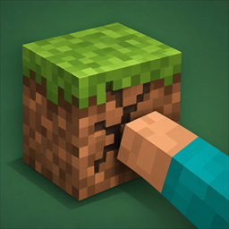

<p align="center">
  
</p>

<h1 align="center">SteadyBreak</h1>

<p align="center">Keeps your block break progress when the server updates the item in your hand.</p>

> [!WARNING]
> SteadyBreak is in alpha. It has not been tested on a live server yet.

## The problem

While you mine, Minecraft compares the held item with the item the break started with, including all
of its data. Any change counts as a tool switch, so the client aborts the break and starts over.

Typical triggers:

- Mending repairing your tool while you collect XP
- Hypixel SkyBlock updating drill fuel, lore or counters

SteadyBreak also stops these updates from replaying the equip animation.

## Install

Requires Minecraft 26.3, Fabric Loader 0.20.1 or newer, and Java 25. Fabric API is not needed.

Put the jar into your `mods` folder. The mod runs on the client only and has no configuration.

## How it works

When Minecraft's comparison fails during an active break on the same block, SteadyBreak checks
whether the item is still the same tool:

| Situation | Result |
| --- | --- |
| Different item type | Reset, as in vanilla |
| Both stacks have a `uuid` in `custom_data` (SkyBlock) | Same tool only if the UUIDs match |
| Otherwise, only `damage` or `lore` differ | Progress kept, neither affects mining speed |
| Any other component differs | Reset, as in vanilla |

Without an active break the mod does nothing, so a new break still sends its START packet.

The equip animation uses the same check, and a count change still plays it.

There is no tick handler, packet hook or config. The mod's code only does work after Minecraft's own
check has failed, and an accepted update refreshes the stored stack so later ticks use the vanilla
path again.

### Known limits

- SkyBlock items without a `uuid` whose `custom_data` changes still reset.
- Swapping between two tools that differ only in `damage` or `lore` keeps progress. Their mining
  speed is identical.
- If a server resets its own break progress, a client mod cannot prevent that.

## Build

Requires JDK 25.

```shell
./gradlew build
```

The jar ends up in `build/libs`. `build` also runs `verifyInLoader`, which calls the patched Minecraft
methods inside the real Fabric loader without opening a game window. To include the mods of a real
instance in that run:

```shell
./gradlew verifyInLoader -PextraModsDir="<path to mods folder>"
```

## Release

1. Set `mod_version` in `gradle.properties` and add the date to `CHANGELOG.md`.
2. Push a tag named `v<mod_version>`, for example `v1.0.0-alpha.1`.

The release workflow builds the mod and creates a GitHub release. Versions with a suffix such as
`-alpha.1` are marked as a pre-release.

## License

[MIT](LICENSE). This project is not affiliated with Mojang, Microsoft or Hypixel.
